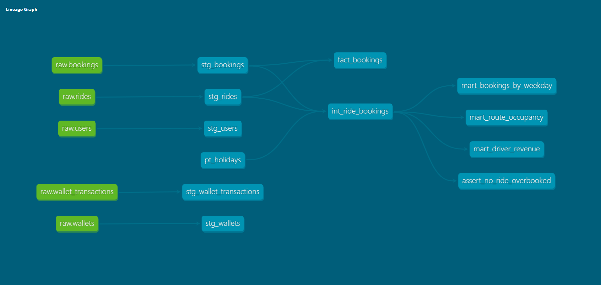

# HopOn Analytics

Analytics layer for HopOn, built with **Snowflake** and **dbt Core** on synthetic data generated from the app's PostgreSQL schema.

## Architecture

```
PostgreSQL (HopOn) -> CSV export (no personal data) -> Snowflake stage -> RAW -> STAGING -> MARTS
                                                                   COPY INTO    dbt views   dbt tables
```

- **RAW:** source tables loaded with `COPY INTO`, untouched. Row counts reconciled against Postgres.
- **STAGING:** one view per source table. Renaming to snake_case, type cleanup, normalized city names.
- **MARTS:** business tables for analysis.

## Models

| Layer | Model | Materialization |
|---|---|---|
| Staging | `stg_users`, `stg_rides`, `stg_bookings`, `stg_wallets`, `stg_wallet_transactions` | view |
| Intermediate | `int_ride_bookings` (one row per ride with seats booked) | ephemeral |
| Marts | `mart_route_occupancy`, `mart_bookings_by_weekday`, `mart_driver_revenue` | table |
| Marts | `fact_bookings` | incremental (merge on `booking_id`) |

- **Seed:** `pt_holidays`, Portuguese public holidays, used to flag rides on holidays.
- **Macros:** `cents_to_euros` (money kept in integer cents, converted to fixed decimals), `generate_schema_name` (writes to `STAGING` and `MARTS` as named).

## Data quality

24 data tests: `unique`, `not_null`, `relationships` and `accepted_values` on every staging model, uniqueness on the holiday seed, and a singular test asserting that no ride is ever booked above its available seats.

## Snowflake setup

- Account on AWS, region `eu-west-3` (Paris).
- Dedicated XS warehouse with 60 second auto suspend and a resource monitor that suspends it at a monthly credit quota.
- dbt connects with key-pair authentication and a least-privilege `TRANSFORMER` role (read on `RAW`, write on `STAGING` and `MARTS`).

## Setup scripts

- `setup/postgres/demo_data.sql`: generates the synthetic data (users, rides, bookings, wallet movements) in the HopOn Postgres, respecting business rules: no overbooking, wallet balances consistent with transactions.
- `setup/postgres/export_csv.sql`: exports the five source tables to CSV, selecting only the columns needed for analysis (no emails, phones, password hashes or documents).
- `setup/snowflake/01` to `05`: warehouse and resource monitor, database and layers, file format and stage, RAW tables with `COPY INTO` and reconciliation, and the dbt role with key-pair auth.

## Running it

```bash
pip install dbt-core dbt-snowflake
# configure ~/.dbt/profiles.yml with a profile named hopon_analytics
dbt seed
dbt build
dbt docs generate && dbt docs serve --port 8001
```

## Lineage

